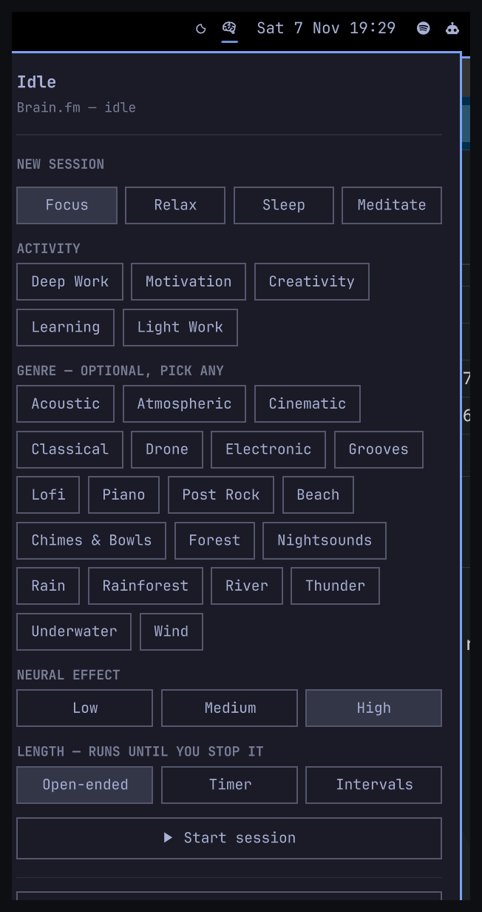

# Brain.fm for Omarchy

Run your [Brain.fm](https://brain.fm) listening session from the Omarchy bar.

The bar item shows what the session is doing right now — idle, buffering,
playing or paused — along with the current track, and says so plainly when the
daemon behind it is not running instead of quietly showing "idle". Click it to
start a session, or to control the one that is playing.



> **Unofficial.** This project is not affiliated with, endorsed by, or
> supported by Brain.fm. You need your own Brain.fm subscription.

---

## Requirements

This plugin is a presentation layer. All the real work — the Brain.fm API,
audio decoding, token renewal, timers, MPRIS — happens in `bfmd`, which you
install separately.

| Requirement | Why | Required? |
|---|---|---|
| [brain.fm-linux-client](https://github.com/MarcFord/brain.fm-linux-client) (`bfmd` and `bfm`) — **0.1.1 or newer recommended** | Supplies every piece of session state and runs the audio | **Yes** |
| A Brain.fm subscription, signed in with `bfm login` | `bfmd` cannot stream without one | **Yes** |
| `setpriv` (from `util-linux`) | Ties the status-watcher child to the shell so it cannot outlive it | **Yes** — already present on Arch/Omarchy |
| `busctl` (from `systemd`) | Reads the daemon's interface version, to decide which controls it can offer | **Yes** — already present on Arch/Omarchy |
| Omarchy 4.x with the Quickshell-based shell | The host this plugin loads into | **Yes** |

### On older daemons

The plugin works against 0.1.0, the first release, but two things are missing
there and it adapts rather than failing:

- **Suggested session lengths.** `bfm list session-lengths` is newer, so the
  Timer mode offers plain durations instead of the ones Brain.fm suggests for
  the mental state you picked.
- **Endless intervals.** They need interface version 6. The option is hidden
  rather than approximated — a missing repeat count means *one* cycle, not
  forever, so a fallback would hand you a single 25-minute round when you
  asked for continuous.

Both are detected at runtime, so upgrading the daemon is enough; nothing in
the plugin needs changing.

Install `bfmd` first and sign in, then confirm it answers before adding the
plugin:

```sh
bfm whoami     # should print: signed in
bfm status     # should print the current state
```

### External commands this plugin runs

The plugin never calls the Brain.fm API itself and ships no network code. It
only ever runs these commands, all of them from `brain.fm-linux-client`:

| Command | When | Why |
|---|---|---|
| `setpriv --pdeathsig TERM bfm status --watch --json` | Once, for as long as the shell runs | The single source of session state. Emits one JSON object per change, so there is no polling. `setpriv` guarantees the child dies with the shell. |
| `bfm list states` | Once at startup | Fills the mental-state picker |
| `bfm list activities --state <state>` | When you pick a mental state | Fills the activity picker |
| `bfm list genres --state <state>` | When you pick a mental state | Fills the genre picker |
| `bfm list session-lengths --state <state>` | When you pick a mental state | Fills the Timer lengths. Newer than the released CLI; when it is not understood the panel offers plain durations instead of inventing Brain.fm's suggestions |
| `bfm play <state> [--activity …] [--genre …]… [--effort …] [--timer …]` | When you press Start | Starts a session |
| `bfm pause`, `bfm resume`, `bfm skip`, `bfm stop` | When you press the matching control | Transport |
| `bfm timer [spec]` | When you change session length on a running session | Sets or, with no argument, clears the timer |
| `busctl --user --json=short get-property dev.marcford.bfm … InterfaceVersion` | Once, after the daemon first answers | Feature detection. Neither `bfm --version` nor its JSON status reports the interface version, and a daemon built from source still calls itself 0.1.0 while serving a newer one |
| `sh -c 'command -v bfm-gtk \|\| command -v bfm-kde \|\| true'` | Once at startup | Decides whether to show the "Open full app" button at all |
| `bfm-gtk` (or `bfm-kde`) | When you press "Open full app" | Launched detached, so closing the shell does not close it |

Nothing is hardcoded that the daemon can answer for: mental states, activities
and genres are all read from it, so this plugin cannot drift from what Brain.fm
offers or from the other front-ends.

`bfmd` itself is never launched by this plugin. It is D-Bus activated, so the
first `bfm` call starts it on demand.

### Privilege boundary

The plugin runs unsandboxed inside the shared Omarchy shell process, as your
user, like every Omarchy plugin. It reads no files, opens no sockets and no
network connections of its own, and writes nothing outside the shell's own
config. Its entire outside contact is the one command above and the read-only
MPRIS data the shell already collects.

---

## Install

```sh
omarchy plugin add https://github.com/MarcFord/brain.fm-omarchy-plugin --enable
```

`--enable` adds the bar item to the centre section of your bar. Leave it off
to install without enabling, then turn it on when you want it:

```sh
omarchy plugin enable marcford.brainfm            # default placement
omarchy plugin enable marcford.brainfm --section right
```

Omarchy does not hot-reload plugin QML — the shell is started with its file
watcher disabled on purpose — so if the item does not appear, restart the
shell:

```sh
omarchy-restart-shell
```

## Usage

The bar item shows one glyph for the current state, plus the track title when
a session is running:

| Glyph | State | Meaning |
|---|---|---|
| 󰧑 | `idle` | The daemon is up; no session is playing |
| 󰎇 | `playing` | A session is playing; the title is shown beside it |
| 󰏤 | `paused` | A session is paused |
| 󰇘 | `buffering` | Waiting on the next track |
| 󰅤 | `unavailable` | **The daemon is not reachable.** Dimmed, and never shown as "idle" |

Hover for a tooltip naming the state and the track, including the timer phase
and time remaining when a timer is set.

### The panel

Click the bar item to open the session panel.

- **While something is playing** — Pause/Resume, Skip and Stop. There is no
  previous-track or seek control: Brain.fm sessions only move forward and the
  daemon reports both as unsupported, so drawing them would be a lie.
- **Starting a session** — pick a mental state, then an activity, any number of
  genres, the neural effect, and a length. Press **Start session**, or just
  press **Enter**.
- **Session length** comes in the three modes the daemon supports, the same
  three the web player offers:

  | Mode | What it does |
  |---|---|
  | **Open-ended** | No timer. Plays until you stop it. |
  | **Timer** | Counts down once, then ends. Lengths are the ones Brain.fm suggests for the mental state you picked — 60/90/120 minutes for focus, 7–9 hours for sleep. |
  | **Intervals** | Alternates work and break — 25 min work / 5 min break, ×4 by default — and the bar tooltip tracks which phase you are in and how long is left. Pick **Endless** to keep cycling until you stop it; that needs a daemon serving interface version 6, and the option is hidden on older ones because there is no spec that fakes it. |

  While something is already playing, **Set this on the current session**
  changes the timer without restarting the session.

  Opening the panel shows the timer that is *actually* running — including one
  set from the CLI or from another app, and one still running from before the
  shell restarted. A spec the controls cannot show (`1h30m`, say) is displayed
  as written and re-applied unchanged rather than being rounded to the nearest
  button.
- **Open full app** launches `bfm-gtk` (or `bfm-kde`). The button is hidden
  when neither is installed.

Mental states, activities and genres are read from the daemon, so they always
match what your account actually offers. Activities and genres differ per
mental state, and change when you pick a different one.

`Esc` closes the panel. You can also bind a key to it:

```sh
omarchy-shell shell summon marcford.brainfm '{}'
omarchy-shell shell hide marcford.brainfm
```

Middle-clicking the bar item toggles pause without opening anything.

Everything here is also available from the CLI:

```sh
bfm play focus --activity "Deep Work" --timer 50m
bfm pause / bfm resume / bfm skip / bfm stop
```

### What this plugin deliberately does not do

- **It does not touch anything outside itself when a timer phase changes.**
  Muting notifications during a work phase, setting do-not-disturb, dimming a
  screen — these are reasonable things to want and they are deliberately not
  here. They are per-person policy, and a bar plugin reaching into unrelated
  parts of your desktop to implement them is overreach.

  `bfmd` has hooks for exactly this. A few lines in its config get you the
  same thing, scoped to your machine and your preferences, with
  `BFM_TIMER_CYCLE` and `BFM_TIMER_CYCLES` available so a script can tell
  "break 3 of 4" from "break 1 of 4". See the brain.fm-linux-client docs.

- **It does not draw a previous-track or seek control**, because the daemon
  reports both as unsupported — Brain.fm sessions only move forward and the
  decoder cannot seek.

- **It does not implement a login flow.** A session token renews indefinitely,
  so signing in is a once-ever thing; the plugin surfaces the failure and
  points at `bfm login --browser`.

### When it says the daemon is not reachable

That glyph means `bfm` could not reach `bfmd` on the session bus. Usually:

```sh
bfm status                 # prints what is actually wrong, and how to fix it
bfm whoami                 # "signed out" means you need: bfm login --browser
```

The plugin reconnects on its own — immediately when the daemon reappears on
the bus, and otherwise on a backoff that tops out at 30 seconds. You should
not have to restart the shell.

## Configuration

Settings live on the bar item's entry in `~/.config/omarchy/shell.json`.

| Key | Type | Default | Meaning |
|---|---|---|---|
| `showTrackTitle` | boolean | `true` | Show the track title beside the glyph. The title is always in the tooltip. |
| `maxTitleWidth` | integer | `180` | Pixels before the title is elided. `0` means no limit. |
| `defaultMentalState` | enum | `focus` | Which mental state the panel opens on. Ignored if your account does not offer it. |

```json
{ "id": "marcford.brainfm", "showTrackTitle": true, "maxTitleWidth": 180,
  "defaultMentalState": "focus" }
```

A vertical bar never shows the title — there is no room for it.

## Removal

```sh
omarchy plugin disable marcford.brainfm   # keep it installed, take it off the bar
omarchy plugin remove marcford.brainfm    # remove it entirely
```

Removal takes the bar entry with it. The plugin stores nothing outside
`~/.config/omarchy/`, so nothing is left behind; `bfmd` and your Brain.fm
session are untouched and are removed separately if you want them gone.

## Development

```sh
git clone https://github.com/MarcFord/brain.fm-omarchy-plugin
cd brain.fm-omarchy-plugin

./dist/check-plugin.sh                 # the same checks CI runs
omarchy plugin validate .              # the check the marketplace runs
```

To try a working copy, install it as a real directory — **not a symlink**.
`omarchy plugin validate` rejects a plugin folder containing symlinks, and a
symlinked folder does not pick up file changes:

```sh
rsync -a --delete --exclude .git --exclude docs ./ ~/.config/omarchy/plugins/marcford.brainfm/
omarchy-restart-shell
qs log -p "$OMARCHY_PATH/shell" --tail 100     # QML errors land here
```

A restart is needed after every change: Omarchy launches Quickshell with
`QS_DISABLE_FILE_WATCHER=1`, so edited QML is not picked up until the shell
restarts. A plugin shares the shell process, so a QML error degrades the whole
bar — check the log rather than assuming silence means success.

## License

MIT. See [LICENSE](LICENSE).
